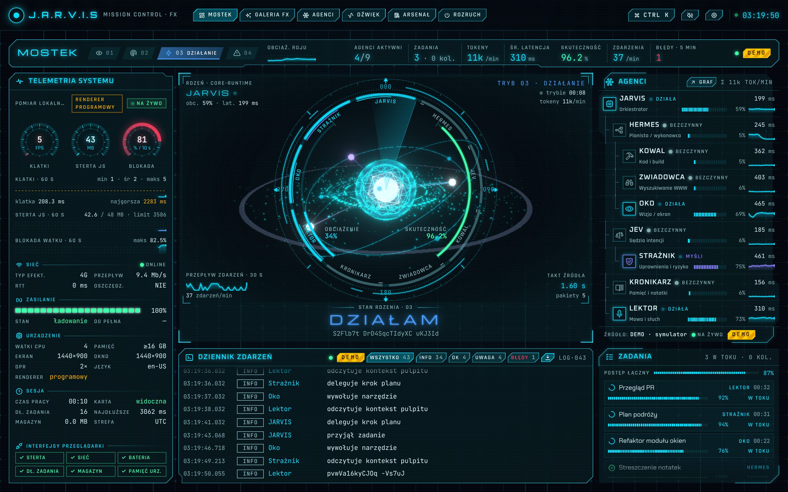
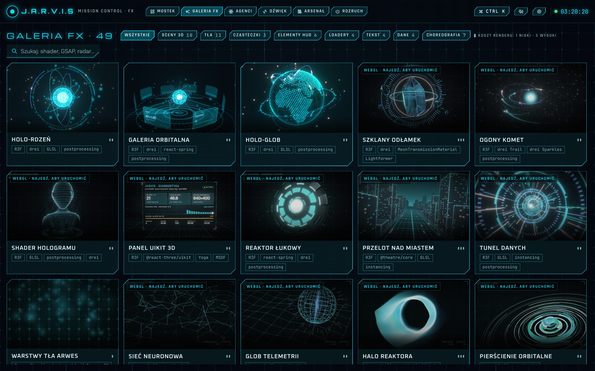
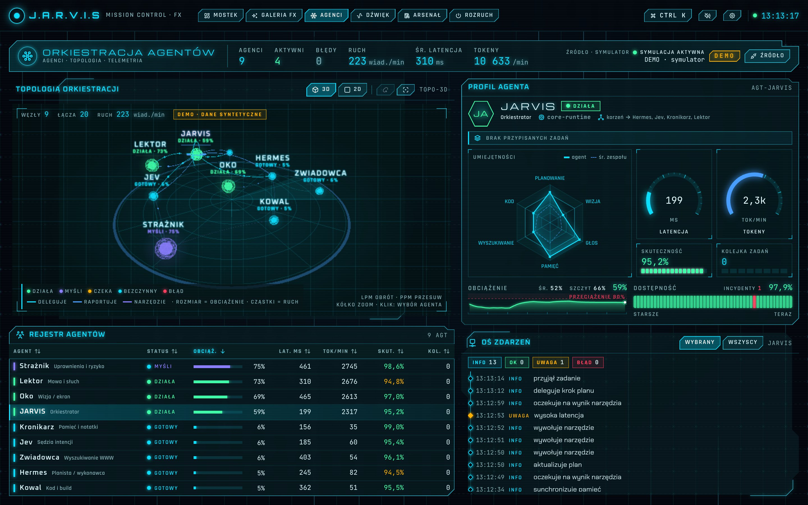
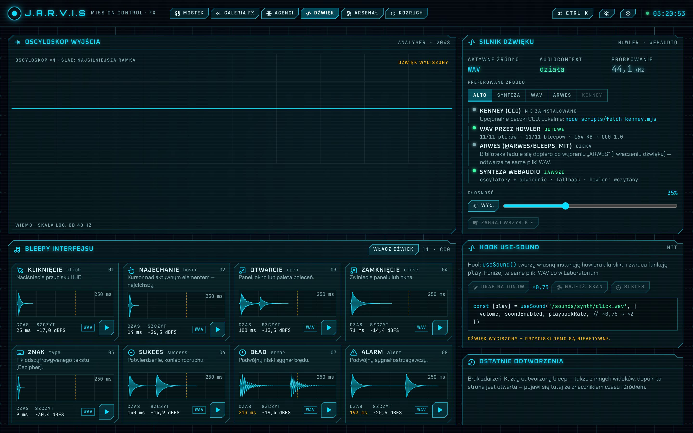
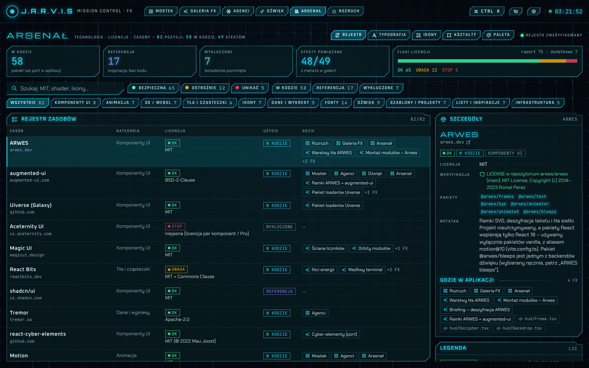
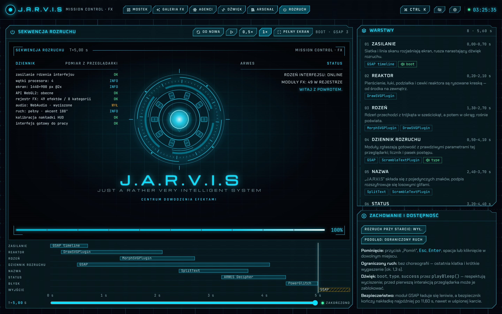
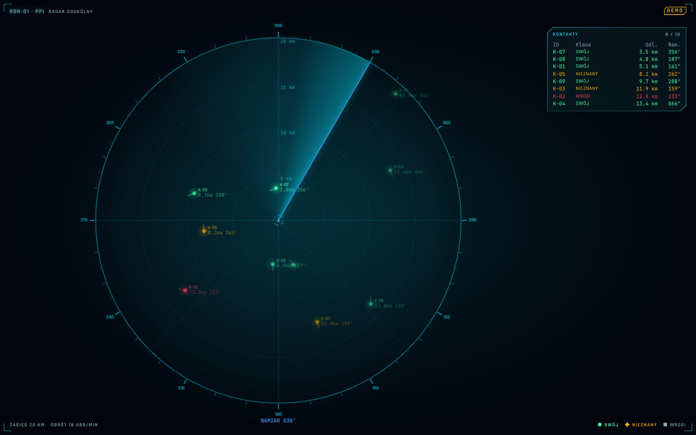

# J.A.R.V.I.S FX · Mission Control

Futurystyczny interfejs HUD w stylu filmowych FUI (Iron Man / Oblivion / TRON), zbudowany w całości z
**darmowego** stosu UI/UX. Aplikacja jest jednocześnie centrum dowodzenia (telemetria przeglądarki, agenci,
dźwięk) i **żywym katalogiem 49 efektów**: sceny 3D, tła, cząsteczki, elementy HUD, loadery, tekst, wykresy i
choreografie ruchu — każdy z parametrami na żywo, licencją i źródłem.

Interfejs jest po polsku. Dane syntetyczne (symulator agentów) są zawsze oznaczone plakietką **DEMO**;
telemetria przeglądarki na Mostku jest prawdziwa.

| | |
|---|---|
|  |  |
|  |  |
|  |  |
|  |  |

> Zrzuty w `docs/screens/*.jpg` są wykonane na renderze programowym (SwiftShader), w rozdzielczości 1440 × 900
> przy DPR 2. Procedura odtworzenia: sekcja „Zrzuty ekranu”.

## Szybki start

```bash
cd jarvis-fx
npm install          # .npmrc ustawia legacy-peer-deps (ARWES deklaruje React 18)
npm run dev          # http://127.0.0.1:5173
npm run build        # tsc -b + vite build → dist/
npm run lint         # oxlint
npm run preview      # podgląd zbudowanej wersji
```

Wymagania: **Node 20.19+ lub 22.12+** (wymóg Vite 8), przeglądarka z WebGL2. W czasie działania aplikacja
nie pobiera zasobów z CDN: fonty, ikony i dźwięki są lokalne. Jedyne połączenia sieciowe to opcjonalne źródło
agentów (WebSocket/SSE, patrz niżej).

### Gotowa aplikacja bez serwera deweloperskiego

Zbuduj wersję ze ścieżkami względnymi i podaj folder `dist/` dowolnemu statycznemu serwerowi:

```bash
VITE_BASE=./ npm run build                        # macOS / Linux
# Windows PowerShell:  $env:VITE_BASE='./'; npm run build
python3 scripts/serve.py                          # Windows: py scripts\serve.py   (albo: python3 scripts/serve.py 9000)
# otwórz http://localhost:8080
```

`scripts/serve.py` wysyła poprawne typy MIME. Na części komputerów Windows rejestr mapuje `.js` na `text/plain`,
a wtedy przeglądarka odrzuca moduły i strona jest pusta. Nie otwieraj `index.html` z dysku (`file://`). Routing jest
po haszu (`#/…`), więc nie wymaga konfiguracji serwera. Test klawiatury na gotowym buildzie:
`node scripts/smoke-keyboard.mjs --base http://localhost:8080`.

| Skrót | Działanie |
|---|---|
| `Ctrl/⌘ + K` | Paleta poleceń: widoki, wszystkie efekty (wyszukiwanie rozmyte, bez polskich znaków też działa), dźwięk, linie skanowania, odcień, jakość, ruch, ponowny rozruch |
| `Alt + 1…6` | Mostek · Galeria FX · Agenci · Dźwięk · Arsenał · Rozruch |
| `?fx=<id>` | Pojedynczy efekt na pełnym ekranie (zrzuty, osadzanie) |
| `#/gallery/<id>` | Galeria z otwartą sceną efektu |
| `#/arsenal/<zakładka>` | `rejestr`, `typografia`, `ikony`, `ksztalty`, `paleta` |

## Widoki

| Widok | Co pokazuje |
|---|---|
| **Mostek** | Rdzeń 3D (R3F), radialny HUD (GSAP), prawdziwa telemetria przeglądarki (FPS, pamięć, sieć, długie zadania), zegary ECharts, sparkline’y visx, agenci i zadania (DEMO). |
| **Galeria FX** | Wszystkie efekty z rejestru jako karty na żywo (lub plakaty, gdy karta nie działa) + scena z panelem Leva. Karty WebGL korzystają z puli kontekstów. |
| **Agenci** | Topologia 2D/3D (react-force-graph), oś zdarzeń, szczegóły agenta (radar umiejętności, tracker dostępności z Tremor). Źródło: symulator albo WebSocket/SSE. |
| **Dźwięk** | Laboratorium bleepów: pięć backendów (Auto, Kenney, WAV, ARWES, synteza WebAudio), oscyloskop, use-sound, polityka licencji. |
| **Arsenał** | Rejestr wszystkich zasobów (licencja, flaga, gdzie użyte) + specimeny fontów, ikon, kształtów i palety. |
| **Rozruch** | Sekwencja startowa (GSAP SplitText/DrawSVG/MorphSVG/ScrambleText, PowerGlitch). |

## Stos

React 19 · Vite 8 (Rolldown) · TypeScript 7 · Tailwind v4 · ARWES (pakiety vanilla: frames, text, bgs, animator,
animated, bleeps) · augmented-ui · Motion 14 · GSAP 3 (wszystkie wtyczki) · anime.js 4 · React Three Fiber 9 +
drei 10 + postprocessing 3 + @react-spring/three + @react-three/uikit + @theatre/core (tylko core) · OGL (dwa
tła React Bits) · tsParticles 4 · Vanta.js na three@0.134 · PowerGlitch · Tabler / Lucide / Phosphor / Material
Symbols / game-icons (Iconify) · ECharts 6 · visx · react-force-graph · howler + use-sound · lottie-react ·
react-spinners · cmdk · Radix · zustand · Leva · Fontsource (12 fontów OFL).

Pełna lista z licencjami: **[LICENSES.md](LICENSES.md)** oraz widok **Arsenał** w aplikacji.

## Architektura w skrócie

```
src/
  App.tsx              powłoka: nagłówek, nawigacja, skróty, paleta, ustawienia, rozruch
  lib/                 store (zustand, ustawienia + useAccent), router (hash), sound, agents, telemetry
  hud/                 Panel, Frame (ARWES), Decipher, Glitch, HudButton, Readout, Backdrop
  fx/
    types.ts           kontrakt efektu (FxMeta, FxProps, kategorie)
    registry.ts        automatyczny rejestr: import.meta.glob('./effects/*/meta.ts')
    FxHost.tsx         montuje efekt (Suspense + ErrorBoundary + wspólne propsy)
    slots.ts           pula kontekstów WebGL dla kart galerii
    controls.tsx       useFxControls() – parametry Leva per scena
    three/HudComposer  wspólny post-processing bezpieczny dla renderera programowego
    effects/<id>/      meta.ts + index.tsx (jeden folder = jeden efekt); *-kit/ = wspólny kod
  views/               bridge · gallery · agents · sound · arsenal · boot
  shell/               CommandPalette (cmdk + Radix Dialog), SettingsMenu
  data/resources.ts    rejestr zasobów i licencji (widok Arsenał)
  styles/              tokens.css (--jx-*), hud.css, global.css (most Tailwind ↔ tokeny), fonts.ts
public/
  sounds/              index.json (paczki), synth/ (nasze WAV-y CC0), kenney/ (opcjonalnie)
  posters/             plakaty efektów dla galerii (scripts/posters.mjs)
scripts/               shoot.mjs · posters.mjs · render-sounds.mjs · fetch-kenney.mjs · check-text-floor.mjs
                       smoke-keyboard.mjs · subset-material-symbols.py · agents-example-server.mjs (przykładowe źródło agentów SSE)
docs/                  ARCHITECTURE.md · gen-licenses.mjs · licenses/ · screens/
```

- **Rejestr efektów** — dodanie folderu w `src/fx/effects/` wystarcza; żaden wspólny plik nie wymaga edycji.
- **Kontrakt efektu** — komponent wypełnia rodzica i dostaje `accent`, `accent2`, `hue`, `quality`,
  `reducedMotion`, `stage` (duża scena vs karta), `paused`.
- **HudComposer** — cały post-processing R3F przechodzi przez jeden wrapper, który na SwiftShader/llvmpipe
  wybiera bufor 8-bit zamiast half-float (inaczej obraz byłby czarny).
- **ARWES + motion@10** — pakiety ARWES wymagają API Motion 10; wtyczka w `vite.config.ts` kieruje import
  `motion` z wnętrza `@arwes/*` do aliasu `motion-v10`, a reszta aplikacji używa Motion 14.
- **Pula WebGL** — przeglądarki ograniczają liczbę kontekstów (~16); karty WebGL w galerii muszą mieć
  „slot” (3–6 zależnie od jakości, 1 przy otwartej scenie); pozostałe pokazują plakat i przejmują najstarszy
  slot po najechaniu kursorem.
- **Źródło agentów** — jeden kontrakt `AgentSource` (symulator DEMO, WebSocket, SSE) i pełne migawki JSON.

Szczegóły: **[docs/ARCHITECTURE.md](docs/ARCHITECTURE.md)**.

## Jak dodać efekt

1. Wybierz unikalne `id` zgodne z kategorią: `r3f-` (kategoria `webgl`), `bg-` (`background`),
   `particles-`, `hud-`, `loader-`, `text-`, `data-`, `motion-`. Kategoria w `meta.ts` decyduje o sekcji
   w galerii, prefiks jest tylko konwencją nazwy. Kategorie to zamknięty zbiór `FX_CATEGORIES`
   w `src/fx/types.ts` — nową kategorię trzeba dopisać tam (i w `FxCategory`), nie tylko w `meta.ts`.
2. Utwórz `src/fx/effects/<id>/meta.ts`:

   ```ts
   import type { FxMeta } from '@/fx/types'
   export const meta: FxMeta = {
     id: 'hud-moj-efekt', // = nazwa folderu
     title: 'Mój efekt',
     category: 'hud',     // webgl | background | particles | hud | loader | text | data | motion
     description: 'Jedno–dwa zdania po polsku: co widać i z czego jest zbudowane.',
     tech: ['Canvas 2D'],
     license: 'MIT (kod własny)',
     source: { label: 'inspiracja / port', url: 'https://…' }, // gdy przeniesione lub inspirowane
     cost: 1,
     tags: ['radar'],
   }
   ```

3. Utwórz `src/fx/effects/<id>/index.tsx` z domyślnym eksportem przyjmującym `FxProps`:

   ```tsx
   import type { FxProps } from '@/fx/types'
   import { useFxControls } from '@/fx/controls'

   export default function Fx({ accent, quality, reducedMotion, stage, paused }: FxProps) {
     const { speed } = useFxControls({ speed: { value: 1, min: 0, max: 3, label: 'Prędkość' } })
     // wypełnij rodzica, posprzątaj rAF/obserwatory przy odmontowaniu, uszanuj paused i reducedMotion
     return <div className="absolute inset-0" style={{ color: accent }} />
   }
   ```

4. WebGL: ustaw `webgl: true`, post-processing tylko przez `<HudComposer>`, a w `<Canvas>` przy `paused`
   użyj `frameloop="demand"`. `drei <Environment preset>` pobiera HDR z CDN — używaj `<Lightformer>`.
5. Kod przeniesiony z innego projektu: nagłówek z adresem źródła, licencją, autorem i „ported/adapted”;
   te same dane w `meta.ts` (`license`, `source`) i w `src/data/resources.ts`; pełna nota MIT/Apache do
   `docs/licenses/` i wpis w `LICENSES.md`, jeśli doszła zależność — `node docs/gen-licenses.mjs`.
6. Sprawdź: `node scripts/shoot.mjs --wait 6000 fx:<id> view:gallery` i obejrzyj PNG w `shots/`, potem
   `node scripts/posters.mjs --only <id>`, żeby galeria miała aktualny plakat. Po każdej zmianie wyglądu
   efektu, a po zmianie zestawu efektów — całość: `node scripts/posters.mjs --base http://127.0.0.1:5173`
   (ok. 8 minut pod renderem programowym). Bez tego plakaty w galerii się zestarzeją.
7. Sprawdź rozmiar tekstu: `node scripts/check-text-floor.mjs` (żaden rozmiar poniżej 10 px; `--fix` podnosi
   wartości w miejscu).

## Jak podłączyć prawdziwe źródło agentów

Widok **Agenci → Źródło** (lub ustawienie `agentSource` w `localStorage['jx-settings']`) przyjmuje:

- `demo` — wbudowany symulator (plakietka **DEMO** w całym interfejsie),
- `ws://host:port/ścieżka` lub `wss://…` — WebSocket, **jedna pełna migawka JSON na wiadomość**,
- `http(s)://host/ścieżka` — Server-Sent Events, jedna migawka na zdarzenie `data:`.

Migawka to `OrchestrationSnapshot` z `src/lib/agents/types.ts`:

```json
{
  "ts": 1763258400000,
  "agents": [{ "id": "a1", "name": "Planista", "role": "orkiestrator", "model": "…", "status": "running",
               "load": 0.42, "latencyMs": 820, "tokensPerMin": 5400, "successRate": 0.97, "queue": 2,
               "skills": { "plan": 0.9, "code": 0.4, "search": 0.6, "memory": 0.7, "voice": 0.1, "vision": 0.2 },
               "history": [0.3, 0.35, 0.42], "uptime": [true, true, false, true] }],
  "links": [{ "source": "a1", "target": "a2", "kind": "delegates", "traffic": 12 }],
  "events": [{ "id": "e1", "ts": 1763258400000, "agentId": "a1", "level": "info", "text": "Przydzielono zadanie" }],
  "tasks": [{ "id": "t1", "title": "Analiza logów", "ownerId": "a2", "progress": 0.4, "state": "active", "startedAt": 1763258300000 }]
}
```

Adapter (`src/lib/agents/remote.ts`) łączy się ponownie z wykładniczym opóźnieniem (do 15 s) i pokazuje
status połączenia. Gotowy, działający przykład bez żadnych zależności (Node 20.19+ / 22.12+):

```bash
node scripts/agents-example-server.mjs     # http://127.0.0.1:8651/agents (SSE, symulowany orkiestrator)
```

W aplikacji wybierz **Agenci → Źródło** i wpisz `http://127.0.0.1:8651/agents`. Zamień `simulate()` i
`buildSnapshot()` w skrypcie na stan własnego orkiestratora; każda wiadomość SSE to jedna pełna migawka.

## Dźwięki: backendy i Kenney

Dźwięk ma pięć preferencji (widok **Dźwięk → Silnik**): **Auto** (Kenney, jeśli zainstalowany → nasze WAV-y →
synteza), **Kenney**, **WAV**, **ARWES** (te same WAV-y przez `@arwes/bleeps`, ładowany dopiero po wyborze) i
**Synteza** WebAudio (zawsze dostępna). Szczegóły i licencje: `public/sounds/README.md`.

Opcjonalne paczki Kenney (CC0) instalujesz na swojej maszynie:

```bash
node scripts/fetch-kenney.mjs                           # pobierz Interface Sounds + Sci-fi Sounds z kenney.nl
node scripts/fetch-kenney.mjs --from-dir ~/Downloads     # albo użyj ręcznie pobranych kenney_*.zip
node scripts/fetch-kenney.mjs --zip a.zip --zip b.zip    # konkretne archiwa
node scripts/fetch-kenney.mjs --remap                    # tylko przebuduj manifest
node scripts/fetch-kenney.mjs --remove                   # odinstaluj
```

Skrypt rozpakowuje tylko audio i licencję do `public/sounds/kenney/`, mapuje pliki na bleepy w
`manifest.json` i dopisuje paczkę do `public/sounds/index.json`. Pliki Kenneya nie trafiają do repozytorium.

**Gdy pobieranie nie działa** (sieć firmowa, proxy, blokada kenney.nl): w przeglądarce pobierz ręcznie
`kenney_interface-sounds.zip` i `kenney_sci-fi-sounds.zip`, a potem uruchom
`node scripts/fetch-kenney.mjs --from-dir ~/Downloads`. Za proxy można też użyć Node ≥ 24 z
`NODE_USE_ENV_PROXY=1 node scripts/fetch-kenney.mjs`.

## Zrzuty ekranu (`docs/screens/`)

Zrzuty do README zapisujemy jako JPEG w `docs/screens/` pod stałymi nazwami: `bridge.jpg`, `gallery.jpg`,
`agents.jpg`, `sound.jpg`, `arsenal.jpg`, `boot.jpg`, `fx-holo-globe.jpg`, `fx-radar.jpg`.

Narzędzia QA wymagają Playwrighta z Chromium, którego nie ma w zależnościach projektu:

```bash
npm i -D playwright && npx playwright install chromium     # albo wskaż istniejącą instalację:
PLAYWRIGHT_MODULE=/ścieżka/do/node_modules/playwright node scripts/shoot.mjs ...
```

```bash
node scripts/shoot.mjs --base http://127.0.0.1:5173 --out docs/screens --dsf 2 --jpeg 82 --wait 8000 \
  view:bridge view:gallery view:agents view:sound view:arsenal view:boot fx:r3f-holo-globe fx:hud-radar-sweep
# skrypt nazywa pliki view_bridge.jpg, fx_r3f-holo-globe.jpg itd. — nadaj nazwy z README:
cd docs/screens && mv view_bridge.jpg bridge.jpg && mv view_gallery.jpg gallery.jpg && mv view_agents.jpg agents.jpg \
  && mv view_sound.jpg sound.jpg && mv view_arsenal.jpg arsenal.jpg && mv view_boot.jpg boot.jpg \
  && mv fx_r3f-holo-globe.jpg fx-holo-globe.jpg && mv fx_hud-radar-sweep.jpg fx-radar.jpg
```

`view:boot` to widok **Rozruch**. Nakładkę pierwszego uruchomienia (sekwencję nad mostkiem) sprawdza się celem
`view:boot-overlay`: `shoot.mjs` czyści `navigator.webdriver`, bo aplikacja pomija nakładkę przy automatyzacji.
Każdy plik powinien mieścić się w ok. 1,2 MB; w razie potrzeby obniż `--jpeg`.

## Jak przenieść folder do osobnego repozytorium

Folder `jarvis-fx/` jest samodzielny (własne `package.json`, lockfile, konfiguracje, `.gitignore`).

```bash
# 1) z zachowaniem historii (z katalogu głównego obecnego repozytorium)
git subtree split --prefix=jarvis-fx -b jarvis-fx-only
mkdir ../jarvis-fx && cd ../jarvis-fx && git init -b main
git pull ../<obecne-repo> jarvis-fx-only
git remote add origin git@github.com:<konto>/jarvis-fx.git && git push -u origin main

# 2) albo bez historii
cp -r jarvis-fx ../jarvis-fx && cd ../jarvis-fx && rm -rf node_modules shots && git init -b main
```

Przed pierwszym commitem w nowym repozytorium dodaj plik `LICENSE` (aplikacja deklaruje MIT, ale pliku
jeszcze nie ma — patrz niżej). Po przeniesieniu: `npm ci && npm run build`. Do hostingu w podkatalogu
(np. GitHub Pages) ustaw `VITE_BASE=/jarvis-fx/ npm run build`. Plakaty `public/posters/` i pliki WAV są
w repozytorium; paczki Kenney nie.

## Licencje

Kod aplikacji: **MIT** (deklaracja autora; plik `LICENSE` w katalogu projektu trzeba dodać przy przenoszeniu).
**Uwaga:** dopóki folder `jarvis-fx/` leży w repozytorium `Deep-Live-Cam`, obowiązuje tam plik `LICENSE` tego repozytorium (GNU AGPL-3.0). Deklaracja MIT dla aplikacji wymaga decyzji autora przed publikacją.
Zależności i zasoby mają własne licencje — **[LICENSES.md](LICENSES.md)** (tabele generowane z `node_modules`:
`node docs/gen-licenses.mjs`). Pełne teksty licencji, których wymaga nagłówek portu, są w `docs/licenses/`.

Najważniejsze zastrzeżenia:

- **GSAP** — *GSAP „no charge” License* (Webflow): darmowy, także komercyjnie, z wszystkimi wtyczkami; nie wolno
  go użyć w narzędziu konkurencyjnym wobec Webflow. Nie jest licencją open source.
- **React Bits** (Threads, Faulty Terminal, Evil Eye, Lightning) — MIT + Commons Clause: wolno używać, nie wolno
  sprzedawać oprogramowania jako produktu lub usługi.
- **game-icons.net** — CC BY 3.0: atrybucja autorów (Lorc, Delapouite & contributors) obowiązkowa.
- **Vanta.js** — wymaga three.js r134; instalowany pod aliasem `three-vanta` obok three 0.187.
- **Theatre.js** — używamy wyłącznie `@theatre/core` (Apache-2.0); `@theatre/studio` (AGPL-3.0) nie jest zainstalowany.

Kodu z LYGIA, Shadertoy, eDEX-UI i Aceternity UI nie używamy.
